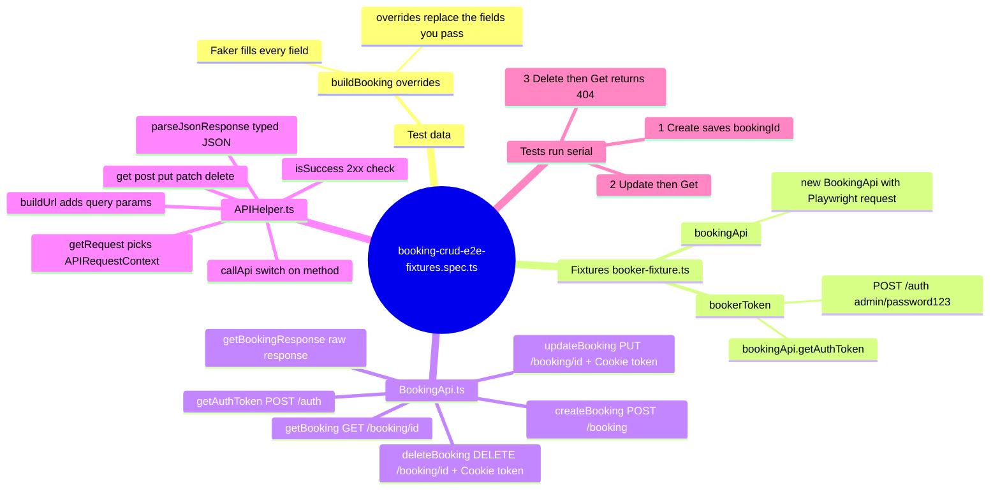
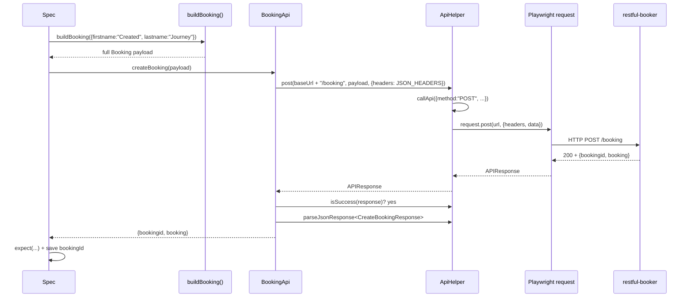
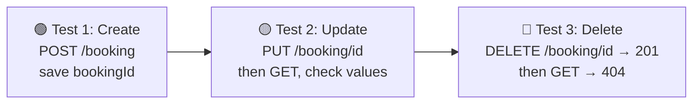

# API Automation Using Fixture + APIHelper (ELI5)

How [booking-crud-e2e-fixtures.spec.ts](../src/tests/apiTests/03_restfulbooker_fixture_e2e_api/booking-crud-e2e-fixtures.spec.ts) creates, updates, reads and deletes one hotel booking.

---

## The 10-second version

Think of a restaurant:

| Restaurant | Our code | Job |
|---|---|---|
| 🧑 Customer | **Spec** (`booking-crud-e2e-fixtures.spec.ts`) | Says *what* it wants and checks what it gets |
| 📝 Order form | **`buildBooking()`** ([api-booking-data.ts](../src/testdata/api-booking-data.ts)) | Fills in the booking details for you |
| 🎒 Waiter kit, ready on the table | **Fixture** ([booker-fixture.ts](../src/fixtures/booker-fixture.ts)) | Gives the spec a ready `bookingApi` and `bookerToken` |
| 🤵 Waiter | **`BookingApi`** ([BookingApi.ts](../src/api/BookingApi.ts)) | Knows the menu: create, get, update, delete |
| 🚚 Kitchen runner | **`ApiHelper`** ([APIHelper.ts](../src/utils/APIHelper.ts)) | Carries any request (GET/POST/PUT/PATCH/DELETE) |
| 🍳 Kitchen | **Playwright `request`** → restful-booker server | Does the real HTTP call |

The customer never walks into the kitchen. Each layer talks only to the one below it.

---

## Mindmap



Plain-text version (if Mermaid doesn't render in your viewer):

```txt
booking-crud-e2e-fixtures.spec.ts
├── Test data ── buildBooking({ firstname, lastname, ... })
│                └── Faker fills the rest, overrides win
├── Fixtures (booker-fixture.ts)
│   ├── bookingApi  = new BookingApi(request, baseURL)
│   └── bookerToken = bookingApi.getAuthToken()  → POST /auth
├── BookingApi.ts  (the "what")
│   ├── createBooking  → POST   /booking
│   ├── updateBooking  → PUT    /booking/:id   (Cookie: token=...)
│   ├── getBooking     → GET    /booking/:id
│   ├── getBookingResponse → GET /booking/:id  (raw response, no throw)
│   └── deleteBooking  → DELETE /booking/:id   (Cookie: token=...)
└── APIHelper.ts  (the "how")
    ├── get / post / put / patch / delete
    ├── callApi() → request.get/post/put/patch/delete
    ├── isSuccess()        → status 200–299?
    └── parseJsonResponse  → response.json() as T
```

---

## One request, top to bottom

Example: `bookingApi.createBooking(payload)` in the **Create Booking** test.



Same path for every call; only the method, URL and headers change.

---

## Step by step

### Step 0: Fixtures get ready (before each test body runs)

```ts
bookingApi: async ({ request, baseURL }, use) => {
    await use(new BookingApi(request, baseURL)) // hand Playwright's request + config baseURL to BookingApi
},
bookerToken: async ({ bookingApi }, use) => {
    const token = await bookingApi.getAuthToken();  // POST /auth
    await use(token)
}
```

- `bookingApi` is built from Playwright's built-in `request` fixture.
- `bookerToken` depends on `bookingApi`, so Playwright builds `bookingApi` first.
- A test only gets a token if it asks for `bookerToken`. **Create Booking** doesn't ask, so it makes no `/auth` call.
- Both are **test-scoped**, so tests 2 and 3 each fetch a fresh token.

### Step 1: The payload comes from `buildBooking()`

```ts
const payload = buildBooking({ firstname: "Created", lastname: "Journey" })
```

Faker fills `totalprice`, `depositpaid`, `bookingdates`, `additionalneeds`. Your overrides replace `firstname` and `lastname`. (Full breakdown: [api-booking-data-readme.md](api-booking-data-readme.md).)

### Step 2: The spec calls a friendly `BookingApi` method

| Test | Spec calls | BookingApi calls ApiHelper | HTTP | Needs token? |
|---|---|---|---|---|
| Create Booking | `createBooking(payload)` | `apiHelper.post(...)` | `POST /booking` | ❌ |
| Update + Get | `updateBooking(id, payload, token)` | `apiHelper.put(...)` | `PUT /booking/:id` | ✅ Cookie |
| Update + Get | `getBooking(id)` | `apiHelper.get(...)` | `GET /booking/:id` | ❌ |
| Delete + Verify | `deleteBooking(id, token)` | `apiHelper.delete(...)` | `DELETE /booking/:id` | ✅ Cookie |
| Delete + Verify | `getBookingResponse(id)` | `apiHelper.get(...)` | `GET /booking/:id` → 404 | ❌ |
| (fixture) | `getAuthToken()` | `apiHelper.post(...)` | `POST /auth` | — |

The token is sent as a cookie by `authHeaders()`:

```ts
{ ...JSON_HEADERS, Cookie: `token=${token}` }
```

### Step 3: Two flavours of every BookingApi method

| Flavour | Example | Returns | On non-2xx |
|---|---|---|---|
| `xxxResponse()` | `getBookingResponse(id)` | raw `APIResponse` | returns it, you check status |
| `xxx()` | `getBooking(id)` | parsed, typed JSON | **throws** an error |

- Happy path → use `xxx()`. The test reads cleanly and fails loudly if the server says no.
- Negative path (expecting 404, 403…) → use `xxxResponse()`. That's why the delete test uses `getBookingResponse()` to assert `404`: `getBooking()` would throw.

### Step 4: ApiHelper does the actual sending

```ts
async put(url, data, options) {
    return this.callApi({ url, method: 'PUT', data, ...options });
}
```

`callApi()`:
1. `getRequest()` → gets the `APIRequestContext` (works whether you passed a `page` or a `request`).
2. `buildUrl()` → adds `?key=value` query params if any.
3. `switch (method)` → calls `request.get/post/put/patch/delete`.

Then `BookingApi` uses two more helpers:
- `isSuccess(response)` → is status 200–299?
- `parseJsonResponse<T>(response)` → `response.json()` typed as `T`.

---

## The whole story: 3 serial tests



- `test.describe.serial` → the tests run in order, one at a time.
- `bookingId` is a `let` in the `describe` block, so test 1 writes it and tests 2 and 3 read it.
- If test 1 fails, serial mode skips the rest (there's no booking to update).
- `testInfo.attach(...)` puts each response's JSON into the report.

---

## Who does what (cheat sheet)

| Layer | Knows about | Does NOT know about |
|---|---|---|
| Spec | Business steps, assertions | URLs, headers, HTTP methods |
| `buildBooking` | Booking shape, fake data | HTTP at all |
| Fixture | How to build `BookingApi`, how to get a token | Test steps |
| `BookingApi` | restful-booker endpoints, auth cookie, types | How HTTP is sent |
| `ApiHelper` | Generic HTTP, status checks, JSON parsing | Bookings |

**Why bother?** If restful-booker changes an endpoint, you fix `BookingApi` once. If you want logging or retries on every call, you add them to `ApiHelper` once. The specs stay the same.

---

## Gotchas worth knowing

1. **Base URL comes from config (fixed).** The fixture passes Playwright's built-in `baseURL` fixture into `new BookingApi(request, baseURL)`, so `TTA_ENV=api` / `API_BASE_URL` now drive the host. If `baseURL` is `undefined`, the constructor default (`https://restful-booker.herokuapp.com`) kicks in. Run API specs with `npm run test:api`: plain `npx playwright test` picks up `BASE_URL` from `.env` (the TTACart host) and would send booking calls there.
2. **DELETE returns `201`, not `200`/`204`.** That's a restful-booker quirk; the test asserts `201` on purpose.
3. **The `deleteBooking` error message says `PATCH`.** That's a copy-paste slip in [BookingApi.ts:164](../src/api/BookingApi.ts#L164) and only affects the error text.
4. **Credentials are hard-coded** (`admin` / `password123`) as defaults in `getAuthToken()`. That's fine for this public demo API; use env vars for anything real.

---

## Run it

```bash
npm run test:api -- src/tests/apiTests/03_restfulbooker_fixture_e2e_api/booking-crud-e2e-fixtures.spec.ts
```
